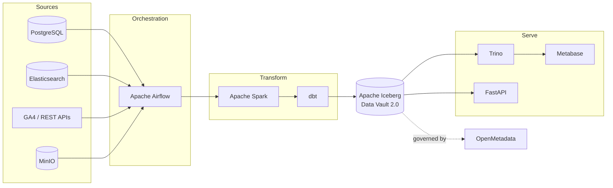

# Yunus Emre Kayaoğlu

**Data Engineer** — Lakehouse & ETL/ELT Specialist · MSc Student @ Karadeniz Technical University

```bash
$ whoami
Data Engineer @ Hangikredi — 2+ years building production ETL/ELT pipelines

$ focus --current
Data Vault 2.0 Lakehouse on Apache Spark, dbt & Iceberg
Data governance & quality with OpenMetadata
```

### How I think about data



### Stack

| | |
|---|---|
| **Languages** | Python · SQL |
| **Orchestration & Transform** | Apache Airflow · Apache Spark · dbt · Apache Iceberg · Trino |
| **Storage** | PostgreSQL · Elasticsearch · MinIO |
| **Governance & Modeling** | OpenMetadata · Data Vault 2.0 · Business Glossary |
| **Serving & Apps** | FastAPI · Streamlit · Metabase |
| **Tooling** | Docker · Git · Bitbucket · Linux · Jira |

### Experience

| Role | Company | Period |
|---|---|---|
| Data Engineer | Hangikredi | Jan 2025 – Present |
| Data Engineering Intern | Hangikredi | Jul 2024 – Jan 2025 |
| Data Scientist Intern | Karadeniz Technical University | Jul 2023 – Aug 2023 |

### Featured Projects

- **Explainable Visual Regression Testing** — automated pipeline for visual regression testing of web interfaces, combining block-level image comparison with DeepSeek-OCR and GPT-4o for semantic explanations.
- **AI-Powered Recommendation System Optimization** (TÜBİTAK 2209-A) — led a research project building data pipelines and ML models (XGBoost, LightGBM, CatBoost) for e-commerce recommendations, shipped as an interactive Streamlit app.

### GitHub Activity

<picture>
  <source media="(prefers-color-scheme: dark)" srcset="https://raw.githubusercontent.com/yunusemrekayaoglu/yunusemrekayaoglu/output/github-contribution-grid-snake-dark.svg" />
  <source media="(prefers-color-scheme: light)" srcset="https://raw.githubusercontent.com/yunusemrekayaoglu/yunusemrekayaoglu/output/github-contribution-grid-snake.gif" />
  
</picture>

<table>
<tr>
<td></td>
<td></td>
</tr>
</table>

### Connect

[](https://linkedin.com/in/yunusemrekayaoglu)
[](https://github.com/yunusemrekayaoglu)
[](https://www.kaggle.com/yunusemrekayaoglu)
[](https://medium.com/@yunusemrekayaoglu)
